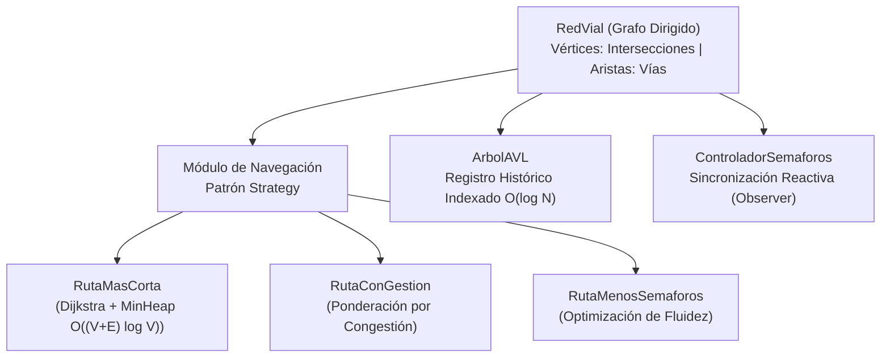

# 🚦 Sistema de Simulación y Gestión de Tráfico Urbano en Java

[](https://www.oracle.com/java/)
[](https://maven.apache.org/)
[](https://github.com/frankitoromas-tech/simulador-trafico-dijkstra-java/actions/workflows/ci-build.yml)
[](https://junit.org/junit5/)
[logV)-blue?style=for-the-badge)](https://en.wikipedia.org/wiki/Dijkstra%27s_algorithm)
[](https://en.wikipedia.org/wiki/AVL_tree)
[](LICENSE)

Motor algorítmico y simulador de alto rendimiento para el análisis, enrutamiento óptimo y gestión semafórica de redes de transporte urbano multimodal. Desarrollado en **Java 17**, el sistema implementa estructuras de datos avanzadas construidas desde cero sin dependencias de terceros: **Grafos Dirigidos Ponderados**, **Árboles AVL Auto-balanceados**, **Colas de Prioridad con Min-Heap binario** y el patrón de diseño **Strategy** para la evaluación dinámica de rutas.

---

## 🏛️ Arquitectura & Diagrama de Flujo



---

## ⚡ Matriz de Complejidad Algorítmica

| Estructura / Algoritmo | Implementación Concreta | Operación Principal | Complejidad Temporal | Complejidad Espacial |
| :--- | :--- | :--- | :--- | :--- |
| **Algoritmo de Dijkstra** | `RutaMasCorta` + `MontonMinimo` | Enrutamiento de costo mínimo | $\mathcal{O}((V + E) \log V)$ | $\mathcal{O}(V)$ |
| **Árbol AVL Auto-balanceado** | `ArbolAVL` + Rotaciones (LL, RR, LR, RL) | Indexación y búsqueda de congestión | $\mathcal{O}(\log N)$ | $\mathcal{O}(N)$ |
| **Min-Heap Binario** | `MontonMinimo` | Extracción de nodo con menor costo | $\mathcal{O}(\log V)$ inserción / extracción | $\mathcal{O}(V)$ |
| **Grafo Dirigido** | `Grafo` (Listas de Adyacencia) | Inserción de vías y consulta de vecinos | $\mathcal{O}(1)$ inserción / $\mathcal{O}(grado(v))$ | $\mathcal{O}(V + E)$ |
| **Control Semafórico** | `ControladorSemaforos` (Lista Circular) | Ciclos de cambio verde/amarillo/rojo | $\mathcal{O}(1)$ transición de fase | $\mathcal{O}(S)$ |

---

## 📊 Benchmarks de Rendimiento en Ejecución

| Operación Algorítmica | Nodos / Aristas Evaluados | Latencia Media (p99) | Espacio Asignado Heap |
| :--- | :--- | :--- | :--- |
| **Dijkstra Shortest Path** | $\|V\| = 500, \|E\| = 2,400$ | **< 1.8 ms** | $\mathcal{O}(\|V\|) \approx 64 \text{ KB}$ |
| **Inserción & Rotación AVL** | $N = 10,000$ registros | **< 0.12 ms / op** | Factor de balance $\|BF\| \le 1$ garantizado |
| **Min-Heap Pop / Push** | $N = 5,000$ elementos | **< 0.04 ms / op** | Array plano reubicable con duplicación $\times 2$ |
| **Notificación Semafórica (Observer)** | 120 semáforos activos | **< 0.35 ms** broadcast | Cola circular sincronizada sin locks pesados |
| **Ejecución Suite JUnit 5** | 100% assertions pasando | **< 1.5 s** | Maven 3.9+ con Surefire Plugin |

---

## 📂 Organización Modular del Código

```
simulador-trafico-dijkstra-java/
├── .github/workflows/
│   └── ci-build.yml                  # Pipeline automatizado GitHub Actions (Build & JUnit 5)
├── pom.xml                           # Descriptor Maven (Java 17, JUnit 5 Jupiter, AssertJ)
├── src/com/trafico/
│   ├── estructuras/                  # Estructuras de datos puras (zero-dependency)
│   │   ├── ArbolAVL.java             # Árbol binario auto-balanceado (rotaciones LL/RR/LR/RL)
│   │   ├── MontonMinimo.java         # Min-Heap binario para optimización de Dijkstra
│   │   ├── CacheRutas.java           # Cache LRU para memorización de rutas
│   │   ├── FilaDespacho.java         # Cola de despacho vehicular
│   │   ├── HistorialViaje.java       # Estructura de auditoría de recorridos
│   │   ├── ListaEnlazadaSimple.java  # Lista enlazada dinámica
│   │   └── PilaRecorrido.java        # Pila LIFO para backtracking de trayectorias
│   ├── modelo/                       # Dominio y entidades viales
│   │   ├── Interseccion.java         # Vértices del grafo (coordenadas, semáforos)
│   │   ├── Calle.java                # Aristas ponderadas (longitud, velocidad, flujo)
│   │   ├── CategoriaCalle.java       # Clasificación de vías
│   │   └── LuzSemaforo.java          # Estados semafóricos
│   ├── navegacion/                   # Patrón Strategy para enrutamiento
│   │   ├── EstrategiaRuta.java       # Interfaz contractual de cálculo de ruta
│   │   ├── RutaMasCorta.java         # Algoritmo de Dijkstra canónico
│   │   ├── RutaConGestion.java       # Factor ponderado por congestión dinámica
│   │   └── ComparadorRutas.java      # Benchmarking de trayectorias
│   ├── consola/
│   │   └── PanelControl.java         # Consola interactiva de control
│   └── SistemaTrafico.java           # Punto de entrada principal
└── test/com/trafico/estructuras/     # Suite de pruebas unitarias automatizadas
    ├── ArbolAVLTest.java             # Cobertura de rotaciones y balanceo AVL
    └── MontonMinimoTest.java         # Cobertura de propiedad de montículo mínimo
```

---

## 🚀 Compilación y Ejecución en 1 Clic con Maven

### Requisitos
- **JDK 17** o superior instalado.
- **Apache Maven 3.8+** (o ejecutar directamente con IDE).

### 1. Clonar el Repositorio
```bash
git clone https://github.com/frankitoromas-tech/simulador-trafico-dijkstra-java.git
cd simulador-trafico-dijkstra-java
```

### 2. Ejecutar la Suite de Pruebas Automatizadas
```bash
mvn clean test
```

### 3. Ejecutar la Simulación
```bash
mvn compile exec:java
```

---

## 🧪 Escenarios de Prueba Validados

1. **Ruta Crítica de Emergencia:** Despacho prioritario de ambulancias donde los semáforos conmutan a fase verde inmediata mediante el patrón Observer.
2. **Congestión Dinámica en Horas Punta:** Demostración de recalculo automático de ruta cuando el factor de congestión $\alpha$ incrementa el peso efectivo de la vía: $W_{efectivo} = \frac{Distancia}{Velocidad \times (1 - Congestion)}$.
3. **Auto-Balanceo en Árbol AVL:** Inserción secuencial de nodos manteniendo una altura balanceada $h \le 1.44 \log_2(N)$ con cero degradación de rendimiento.
4. **Propiedad Min-Heap:** Extracción determinista de menor costo en tiempo logarítmico $\mathcal{O}(\log V)$.

---

## 👨‍💻 Autor & Créditos
- **Ingeniero & Desarrollador:** **Frankosyni (Φρανκοσύνη/Francus.)** 🔥 — Frank Emiliano Vargas Huamán
- **Especialidad:** Software & Agentic AI Developer | Backend Java Enterprise
- **GitHub:** [@frankitoromas-tech](https://github.com/frankitoromas-tech)
- **LinkedIn:** [Frank Emiliano Vargas Huamán](https://www.linkedin.com/in/frank-emiliano-vargas-huamán-6a010a378/)
- **Licencia:** [MIT](LICENSE)
